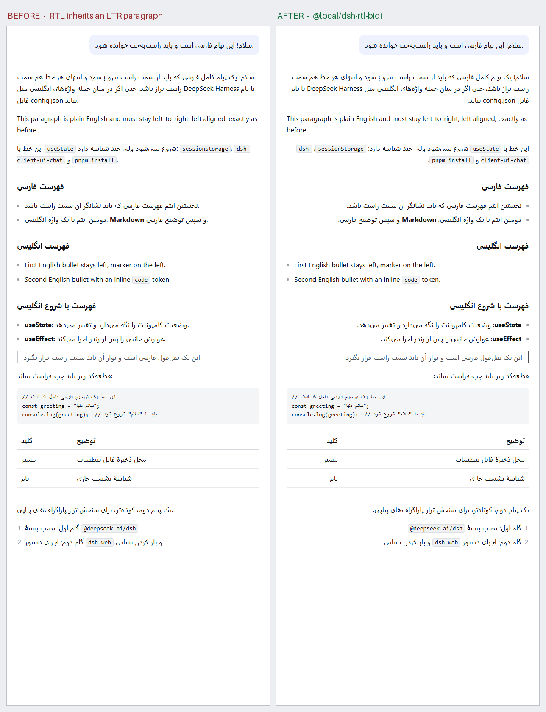

# Persian & RTL Text for DeepSeek Harness

A [DeepSeek Harness](https://github.com/deepseek-ai/deepseek-harness) bundle that
makes right-to-left content (Persian/Farsi, Arabic, Hebrew) render correctly in
the Web UI — including messages that mix RTL text with English words,
identifiers, filenames and inline code.

A plugin bundle for the `desktop`/Web profile. No build step, no dependencies,
no Host services: a stylesheet and a small DOM observer in the browser half.

## The problem

The Harness shell is authored left-to-right: no stylesheet sets `direction` and
no element carries a `dir` attribute. Every message therefore inherits an LTR
paragraph level, so Persian text shows up with:

- wrong alignment (ragged-right lines packed to the left),
- list markers and block-quote bars on the wrong side, sometimes overlapping text,
- sentence-final punctuation on the wrong end,
- mixed Persian/English lines that read in the wrong order.

## What it does

| Layer | Behaviour |
| --- | --- |
| Paragraph direction | Each paragraph, list item, heading, quote and table cell resolves its own base direction (UAX #9 first-strong), so RTL and LTR paragraphs coexist in one message. |
| Alignment | Blocks align to their *resolved* direction instead of the inherited one. |
| Mixed lines | A block that *starts* with an English term but is otherwise Persian (`` - `useState`: وضعیت کامپوننت ``) is pinned to RTL by a majority heuristic instead of being read left-to-right. |
| Code | `pre`, `code`, `kbd`, `samp` and code-block chrome are forced LTR and isolated, so snippets, paths and shell commands inside a Persian sentence never re-order. |
| Logical geometry | List indentation, block-quote bars and task-list checkboxes use `inline-start/end`, so RTL lists keep their markers on the right without overlapping text. |
| Composer | Plain inputs/textareas get `dir="auto"`; the Lexical editor already applies it to its editable roots. |

Only transcript and Markdown surfaces are affected (`[data-chat-flow]`,
`[class*="_markdown_"]`); sidebars, settings and other chrome keep their LTR
layout.

## Before / after



Left: the current behaviour — Persian lines left-aligned, markers on the left,
quote bar on the left, mixed lines out of order. Right: the same document with
this bundle installed.

## Install

Install it into a Harness profile with the Plugin Manager, using the repository
as the installation spec:

```
github:Farzin-CS/DeepSeek-Harness-RTL
```

or cloned at a pinned release:

```
github:Farzin-CS/DeepSeek-Harness-RTL#v1.0.0
```

or clone it and install the directory path:

```bash
git clone https://github.com/Farzin-CS/DeepSeek-Harness-RTL.git
# then install the local directory as a bundle
```

The bundle inserts one Loader row (`rtl-bidi`) after the profile's other
bundles. Reload the page once after installing; the stylesheet and observer are
attached when the Client module boots. Disable or remove it from
**Settings → Plugins** at any time.

## Verifying the rendering

`test/fixture.html` reproduces the transcript DOM and the relevant shipped
Markdown CSS; `test/compare.html` shows both states side by side. With a
Chromium-based browser:

```bash
msedge --headless=new --allow-file-access-from-files --hide-scrollbars \
  --window-size=620,1600 --virtual-time-budget=6000 \
  --screenshot=test/after.png \
  "file:///<repo>/test/fixture.html?plugin=1"
```

`--dump-dom` on the same URL shows the pinned blocks:
`data-dsh-dir="rtl"` on Persian blocks, `data-dsh-dir="ltr"` on English ones,
and no attribute on blocks that only contain digits or punctuation.

## Known limits

- Direction is decided per block with the first-strong heuristic plus a
  Persian-majority override. A deliberately English-first sentence that
  mentions one Persian word stays left-to-right.
- Markdown tables keep left-to-right column order; cell text is aligned per cell.
- Rendering uses the browser's fallback font for Arabic-script glyphs; the
  bundle does not ship or select a Persian font.
- Blocks that only contain digits/punctuation keep the surrounding direction.

## Development

`client.js` is a prebuilt browser module in the platform's
`window.__ModuleLoader__.load({ id, factory })` format — there is no compile
step. Edit it, then reload the page; a locally linked install picks up the new
file directly.

The stylesheet is a template string near the top of the module, so it stays in
source order (prose rules, then code rules, then the pinned-direction rule that
wins over the heuristic).

## License

MIT — see [LICENSE](LICENSE).
